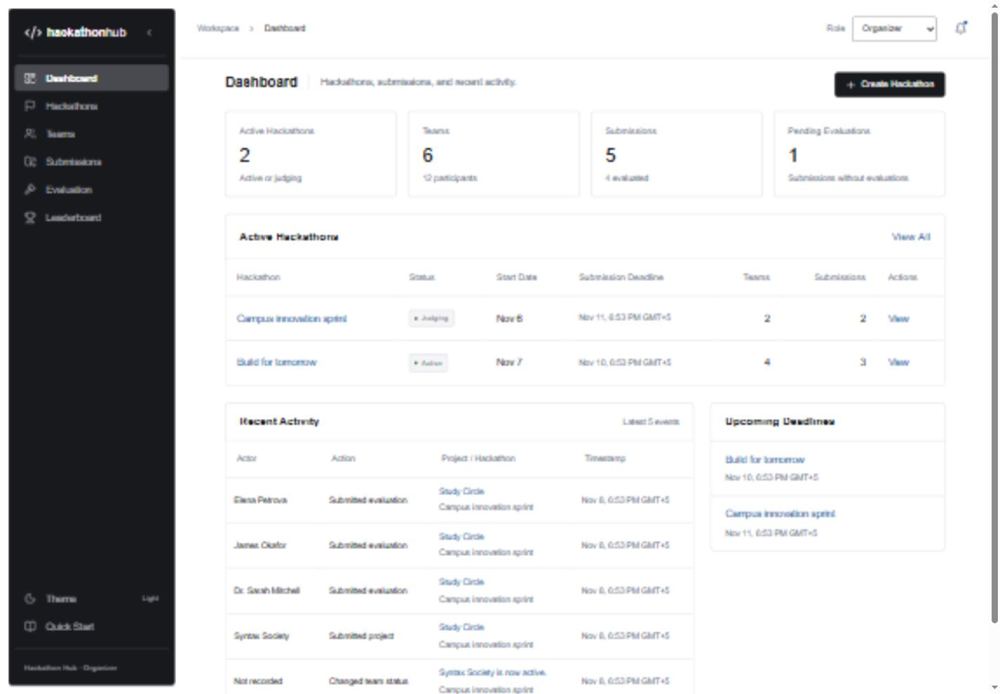

# Hackathon Hub

**A complete hackathon management and evaluation platform built for the Software Design Patterns final project.**

Organize an event, define challenges, form a team, submit a project, collect judge feedback, compare scoring models, and export the results. Every workflow uses a real Spring Boot API and persistent PostgreSQL storage. The interface has Organizer, Participant, and Judge perspectives without account setup.



## What works

- Event creation, editing, status transitions, cancellation, and deletion of events without teams.
- Coding, pitch, and quiz challenges with distinct validation rules.
- Team profiles, technology stacks, participant membership, and team status changes.
- Guided project submissions with validated repository, presentation, and demo links.
- Criterion-based evaluations, immutable original scores, and persistent scoring configuration.
- Standard, Olympic, and Weighted scoring; composed bonuses and penalties; tied rankings and pending states.
- Persistent observer notifications and audit history, with 15-second activity polling.
- Sortable project rankings, accessible score comparisons, JSON downloads, and paginated Unicode PDF reports.
- HackerEarth-inspired tables, functional filters/pagination, collapsible role-aware navigation, light/dark themes, keyboard-operable dialogs, error recovery, and system typography.

## Stack

| Layer | Implementation |
|---|---|
| Backend | Java 21, Spring Boot 3.5.16, Spring Web, Validation, Spring Data JPA, Hibernate |
| Database | PostgreSQL, Flyway SQL migration, foreign keys and uniqueness constraints |
| Frontend | React 19, TypeScript, Vite 7, Tailwind CSS 4, React Router, Axios, Lucide, Recharts |
| Exports | OpenPDF with bundled SIL-licensed Noto Sans; JSON DTO reports |
| Tests | JUnit 5, Mockito, Spring Boot Test, MockMvc, Vitest, React Testing Library |
| Tooling | Maven 3.9.9 wrapper, npm lockfile, Docker Compose for PostgreSQL |

## Quick start on Windows

Prerequisites: **Java 21**, **Node 22.12+ or Node 24**, and a local **PostgreSQL 15+** installation. Java 21, Node 24, and PostgreSQL 15 were used for the recorded verification.

From the repository root in PowerShell:

```powershell
.\scripts\start-local.ps1
```

This creates an isolated PostgreSQL cluster under `.runtime/pgdata` on **127.0.0.1:55432**, runs backend tests and packaging, installs frontend dependencies if needed, runs component tests and the production build, and starts the two app processes. Open **[http://127.0.0.1:5173](http://127.0.0.1:5173)**. Logs and process IDs are under `.runtime/`.

The local helper uses trust authentication on loopback for this disposable development cluster. The Docker configuration below uses a password. Runtime data and local configuration are excluded from Git.

```powershell
# Restart already-built code without rebuilding
.\scripts\start-local.ps1 -SkipBuild

# Stop the owned app processes and project-local database; keep all data
.\scripts\stop-local.ps1
```

If PowerShell blocks local scripts, use the manual startup commands below. The helper requires ports 8080 and 5173 to be free; it restarts only processes it previously recorded.

## Docker PostgreSQL and manual startup

Docker Desktop must be running. Copy `.env.example` to `.env`, then:

```powershell
docker compose up -d db
.\mvnw.cmd -B verify
java -jar backend/target/backend-1.0.0.jar
```

In a second terminal:

```powershell
cd frontend
npm ci
npm run dev
```

On macOS/Linux, use `./mvnw -B verify` for Maven. The database defaults to `localhost:5432/hackathon_hub` with username/password `hackathon`. Its Compose volume persists across restarts. `docker compose down` preserves that volume.

Spring Boot does **not** automatically load the root `.env` file. Compose uses it; set custom backend values in your shell before running Java. For example, if port 5432 is occupied:

```powershell
$env:DB_PORT='5433'
docker compose up -d db
$env:DB_URL='jdbc:postgresql://localhost:5433/hackathon_hub'
java -jar backend/target/backend-1.0.0.jar
```

| Variable | Default / purpose |
|---|---|
| `DB_URL` | `jdbc:postgresql://localhost:5432/hackathon_hub` |
| `DB_USER` / `DB_PASSWORD` | `hackathon` / `hackathon`; change for shared environments |
| `DB_PORT` | Compose host port, default 5432 |
| `PORT` | Backend port, default 8080 |
| `FRONTEND_ORIGIN` | Comma-separated allowed origins; defaults to localhost and 127.0.0.1 on port 5173 |
| `SEED_DATA` | `true`; inserts sample data only into an empty application database |
| `VITE_API_URL` | Optional frontend API base; default `/api` through the Vite proxy |
| `API_PROXY_TARGET` | Development proxy target; default `http://127.0.0.1:8080` |

## Demo in five minutes

1. As **Organizer**, create an active hackathon. Open it and set criterion weights to total 100%. Add a coding, pitch, or quiz challenge.
2. Switch to **Participant**. Create a team, open its profile, and add members.
3. Submit a project with a valid HTTP/HTTPS repository URL. Choose an optional challenge. Editing is available before the effective deadline and first evaluation.
4. Switch to **Judge**. Select the project, enter every criterion score, and submit. Repeat with a different judge name to demonstrate multiple perspectives.
5. As **Organizer**, change the scoring model and enable compatible adjustments. View the recalculated leaderboard, expand the score breakdown, and download JSON and PDF reports.

The sidebar's Quick Start explains the same journey. Navigation, routes, and actions follow the selected demo role. The API remains unauthenticated; this is **UI role gating, not server authorization**.

The initial dataset contains 2 hackathons, 6 teams, 12 participants, 6 challenges, 5 projects, and 12 judge evaluations. One project awaits review. Names and project links are illustrative sample data. Dates are relative to the first seed run and are not silently reset on later launches.

## Architecture and six patterns

```text
backend/src/main/java/dev/hackathon/hub/
  controller/  dto/  mapper/  entity/  repository/
  service/  exception/  config/
  patterns/builder/  factory/  strategy/  observer/  decorator/  facade/
frontend/src/
  api/  components/  hooks/  pages/  types/  utils/  test/
```

Controllers accept validated DTOs and delegate to transactional services. JPA entities never cross the API boundary. Writes use database constraints and event-level locks; audit and notification writes share the originating transaction. Leaderboards are derived from original evaluations rather than saved as modified scores. The original `src/main/java/org/example/Main.java` starter is retained; the executable application is in `backend/`.

| Pattern | Core implementation | Demonstration |
|---|---|---|
| Builder | `SubmissionBuilder`, `SubmissionValidationException` | Guided project construction, required fields and URL checks |
| Factory Method | Abstract `TaskCreator`; Coding/Pitch/Quiz creators and task subclasses | Create three challenge types with different validation |
| Strategy | `ScoringStrategy`; Standard/Olympic/Weighted implementations | Switch models in Evaluation or Leaderboard |
| Observer | Explicit publisher/listener interfaces; notification and audit observers | Submit or evaluate a project; inspect the activity inbox |
| Decorator | `ScoreComponent`, base component, abstract decorator, three concrete decorators | Compose score adjustments and inspect the breakdown |
| Facade | `HackathonEvaluationFacade` | Submit an evaluation through one API call coordinating validation, persistence, calculation, and notification |

See [the project report](docs/PROJECT_REPORT.md) for UML, formulas, extension points, domain rules, and attribution placeholders.

## Testing and evidence

```powershell
.\mvnw.cmd -B verify
cd frontend
npm ci
npm test
npm run build
npm audit
```

Recorded results: **22 backend tests and 23 frontend tests passed**, the executable backend package and production frontend build succeeded, and dependency auditing found zero known vulnerabilities. Tests use H2 in PostgreSQL compatibility mode with the actual Flyway migration; live verification separately used PostgreSQL 15, including an exact data comparison after a backend restart. The redesign also passed 56 page/theme/viewport checks and an isolated browser workflow with real API writes and exports. Docker Compose configuration was validated, but the Docker engine was not running during this session.

- [Test scenarios and actual results](docs/TEST_RESULTS.md)
- [Current UI/UX review, findings, and fixes](docs/UI_REDESIGN_REVIEW.md)
- [Design system](design-system/hackathon-hub/MASTER.md)
- [API reference](docs/API.md)
- [Screenshots](docs/screenshots/)

## Scope and limitations

This is an account-free, small-cohort university application. It deliberately omits OAuth, payments, real email delivery, and microservices. The API is unauthenticated and must not be exposed as a production multi-user service without adding authorization. Lists are sized for a small hackathon cohort rather than paginated at enterprise scale. The leaderboard ranks project submissions, identified by team; a team with multiple projects can appear more than once. Criteria lock after the first evaluation, closed events lock changes, and original judge evaluations are immutable. The PDF font supports Latin/Cyrillic text; emoji and CJK are outside its bundled glyph coverage.
