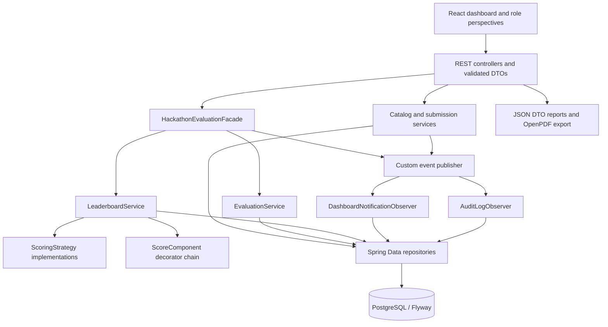
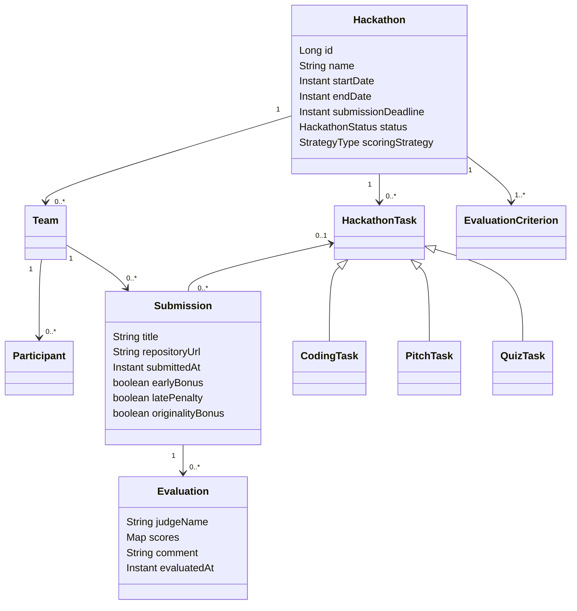
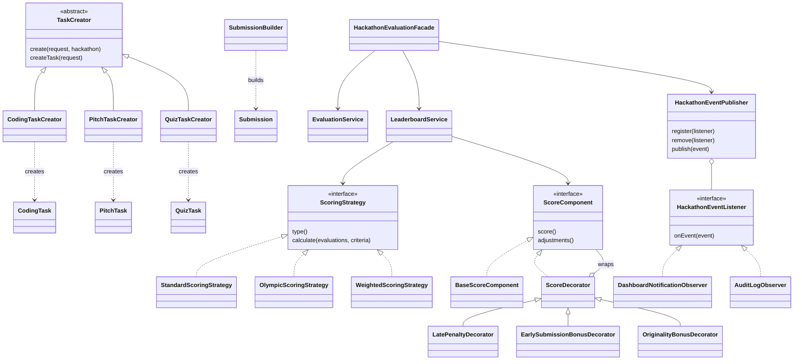
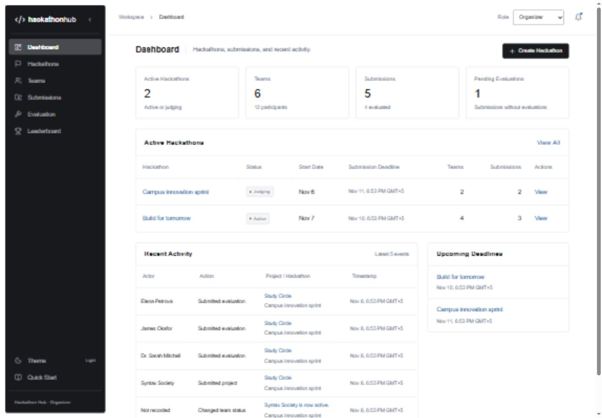
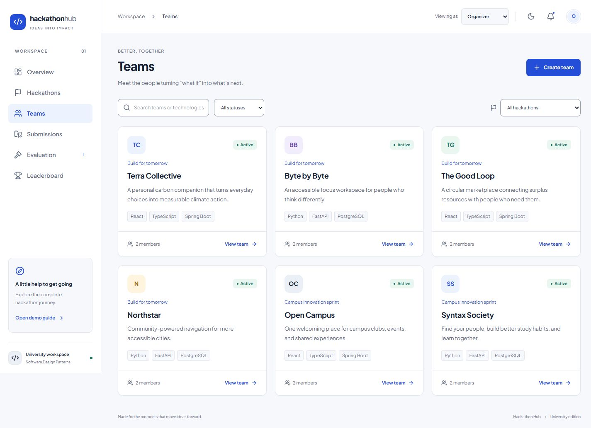
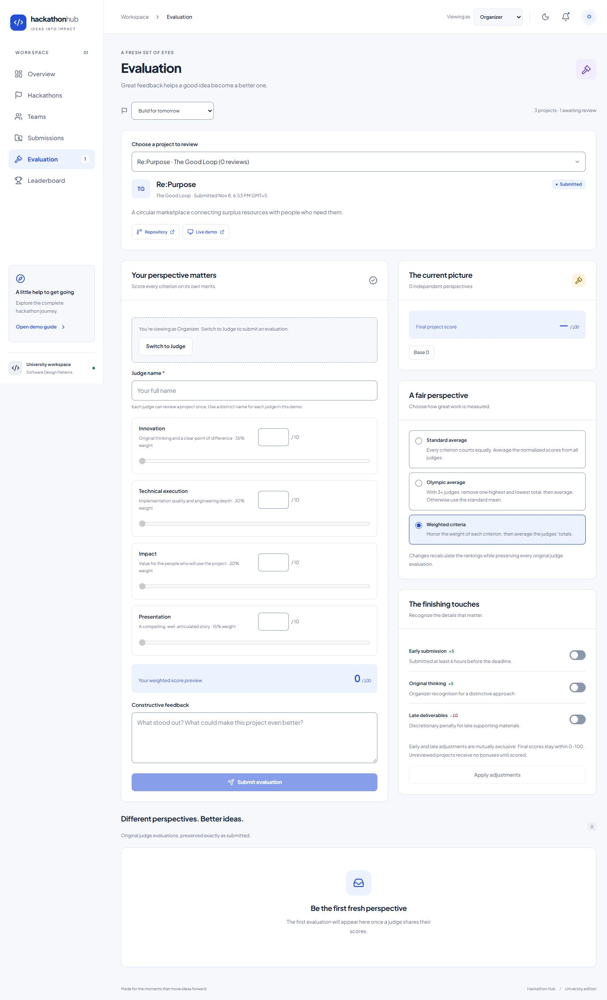
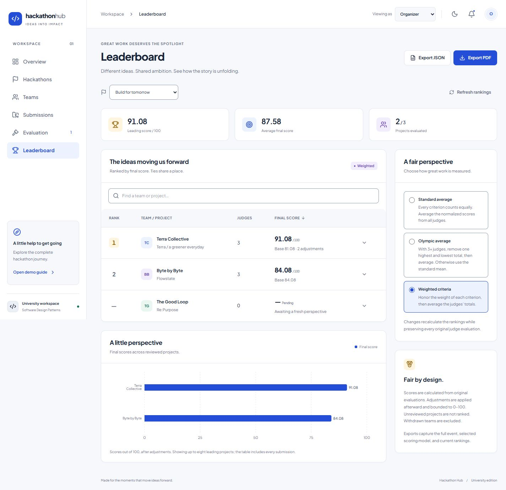

# Hackathon Hub
## Hackathon Management & Evaluation Platform

**Course:** Software Design Patterns

**Institution / group:** [To be supplied]

**Students:** [Student names to be supplied]

**Verification date:** November 8, 2026

## 1. Introduction

Hackathon Hub is a working monolithic web application for coordinating hackathons from event setup to final evaluation. It combines a Java 21 / Spring Boot backend, PostgreSQL persistence, and a React / TypeScript dashboard. Its central educational objective is to demonstrate six manually implemented design patterns in real workflows, with executable tests and visible outcomes.

## 2. Problem statement

Hackathons require organizers to coordinate deadlines, team membership, project links, judging criteria, independent evaluations, and results. Spreadsheets and disconnected forms make it difficult to preserve the original scores while experimenting with scoring rules or explaining a final ranking. The system provides one consistent workspace with explicit rules, durable records, and transparent score breakdowns.

## 3. Objectives and scope

The project supports the complete journey: create an event, configure criteria and tasks, create a team, submit a project, evaluate it, compare strategies, apply compatible modifiers, and export results. It also makes observer-driven activity visible and preserves all data after a restart.

Three logical roles are available through an interface switch. Authentication, payments, real email delivery, and distributed services are intentionally outside the project. The role selector demonstrates perspectives rather than providing security enforcement.

The original small Java starter is preserved in `src/main/java/org/example/Main.java`.

## 4. User scenarios

| Role | Scenario | Outcome |
|---|---|---|
| Organizer | Create an active event, set valid dates, configure normalized criteria, and add different tasks | Teams receive a clear challenge and evaluation framework |
| Participant | Create a team, add members, describe the stack, and submit links before the deadline | A validated project is persisted and observers announce it |
| Judge | Select a project, score every criterion, and provide feedback under a unique judge name | Original evaluation is saved and rankings recalculate |
| Organizer | Compare Standard, Olympic, and Weighted models | The same original evaluations produce explainable alternative results |
| Organizer | Apply early/originality bonuses or a discretionary late-deliverable penalty | Decorators extend the derived score and expose each adjustment |
| Any demo role | Read the leaderboard and download JSON/PDF | Current configuration and results can be reviewed outside the app |

## 5. System architecture



Controllers remain thin. Services hold business rules and transaction boundaries. Constructor injection exposes dependencies. Request and response DTOs prevent lazy entity leakage and circular serialization. Centralized exception handling provides meaningful validation/conflict errors and hides internal stack traces.

Foreign keys and uniqueness constraints protect relationships. Team names and judge names have normalized keys for case-insensitive uniqueness in their respective scopes. Event-level write locks serialize coordinated event mutations. The two custom observers persist their effects inside the originating transaction; an observer failure therefore causes the workflow to roll back rather than leaving partial audit/notification records.

## 6. Domain model and rules

| Entity | Responsibility |
|---|---|
| Hackathon | Event description, time boundaries, lifecycle status, and selected strategy |
| Team | Event-specific team identity, stack, description, and participation status |
| Participant | A named member, email, and role inside one team |
| HackathonTask | Abstract challenge with Coding, Pitch, and Quiz product subclasses |
| EvaluationCriterion | A criterion name, maximum, description, and positive normalized weight |
| Submission | Project details and links, team/task association, submission time, status, and modifier flags |
| Evaluation | Immutable judge name, original criterion score map, feedback, and evaluation time |
| Notification / AuditLog | Persistent observer effects and activity history |



Dates follow `start < end`, with the submission deadline between them. Events move Draft → Active → Judging → Completed; Draft/Active/Judging may also become Cancelled. Terminal events lock edits. New events begin Draft or Active.

New teams register in Draft/Active events. Team ownership cannot move to another event. Withdrawn teams remain stored but are excluded from evaluation and rankings. Each team/email pair is unique.

Submissions are accepted only in an Active event, before the earlier of the event and assigned-task deadlines. Project title, description, team, and an HTTP/HTTPS repository URL are required. Optional links are validated by the same scheme/host rule. Edits stop at the effective deadline or first evaluation. A task must belong to the team's event.

An evaluation supplies exactly one finite, in-range score for each criterion. Each judge may evaluate a submission once. Criteria lock after the event's first evaluation so existing scores retain their original meaning.

## 7. Six design patterns

| Pattern | Category | Problem solved | Main classes / interfaces | Demonstration | Responsible student |
|---|---|---|---|---|---|
| Builder | Creational | Valid construction of a project with optional links and task | `SubmissionBuilder`, `SubmissionValidationException`, `Submission` | Submit a project or attempt an invalid URL | [To be assigned] |
| Factory Method | Creational | Different task products require different creation rules | `TaskCreator`, three creator subclasses, three task entity subclasses | Create Coding, Pitch, Quiz challenges | [To be assigned] |
| Strategy | Behavioral | Organizers need interchangeable formulas without rewriting evaluations | `ScoringStrategy`, Standard/Olympic/Weighted classes | Change model in Evaluation/Leaderboard | [To be assigned] |
| Observer | Behavioral | Submission/evaluation/team changes have multiple independent reactions | `HackathonEventPublisher`, `HackathonEventListener`, notification/audit observers | Submit or evaluate; inspect notification and audit stores | [To be assigned] |
| Decorator | Structural | Derived scores need independently composable adjustments | `ScoreComponent`, `BaseScoreComponent`, `ScoreDecorator`, three decorators | Apply bonuses and inspect breakdown | [To be assigned] |
| Facade | Structural | Controllers should not coordinate the entire evaluation process | `HackathonEvaluationFacade` and existing services | One evaluate call persists, calculates, and publishes | [To be assigned] |

### Builder

The builder accumulates title, description, repository, optional presentation/demo, team, and task. `build()` enforces construction invariants and returns a usable Submission. SubmissionService uses it for both creation and validated replacement details. This is application logic, not a framework-provided builder annotation.

### Factory Method

`TaskCreator.create()` invokes an abstract `createTask()` overridden by subclasses. Coding requires a meaningful brief, Pitch requires 1–30 minutes, and Quiz requires 1–100 questions. A registry of creator beans selects the appropriate subclass; there is no single switch-based class pretending to be Factory Method. Product subclasses are persisted through JPA single-table inheritance.

### Strategy and scoring mathematics

For judge `j` and criterion `c`, normalized points are `n(j,c) = 100 × raw(j,c) / max(c)`.

- **Standard:** `u(j) = sum(n(j,c)) / criterionCount`, then average `u(j)` over judges.
- **Olympic:** sort the Standard judge totals; with 3+ judges remove exactly one minimum and one maximum, then average. With 1–2 judges use the mean; with none return zero/pending.
- **Weighted:** require positive finite weights summing to one within `0.000001`; compute `w(j) = sum(weight(c) × n(j,c))`, then average across judges.

Only output values are rounded to two decimals. Strategies never mutate evaluations. To demonstrate extensibility, add a `MEDIAN` strategy enum value and a bean implementing `ScoringStrategy`; reuse normalized Standard judge totals and select the middle value(s). The service's registry requires no algorithm switch.

### Observer

The custom publisher explicitly implements `register`, `remove`, and `publish` over registered listeners. SubmissionCreated, EvaluationSubmitted, and TeamStatusChanged events are immutable application events. DashboardNotificationObserver and AuditLogObserver independently persist the same meaningful event. Spring's own event system is not counted as this pattern. The UI polls activity every 15 seconds and refreshes immediately after its own writes.

### Decorator

The base component supplies the strategy score. Every decorator wraps the same `ScoreComponent` interface and contributes both an amount and an explanatory adjustment. Early submission adds 5, originality adds 5, and a discretionary late supporting-deliverable penalty subtracts 10. Early eligibility is checked when applying it: submission must be at least six hours before its effective deadline. Early and late flags cannot coexist. Late project submission itself is rejected; the late modifier concerns supporting deliverables.

Scores are bounded once, after composition: `final = min(100, max(0, base + adjustments))`. A clamp adjustment is included in the breakdown when needed. Unreviewed projects remain pending and gain no modifier points. Original evaluation rows remain unchanged. Adding another modifier requires a new decorator and an explicit configuration/control choice, rather than modifying existing decorators.

### Facade

`evaluateSubmission()` delegates validation and persistence to EvaluationService, obtains a derived leaderboard from LeaderboardService, publishes the evaluation event, and returns the prepared result under one transaction. Strategy and modifier changes use the same coordination surface. The Facade does not duplicate individual services' validation or formulas.

## 8. Pattern UML class diagram



## 9. Evaluation sequence diagram

```mermaid
sequenceDiagram
  actor Judge
  participant UI as React evaluation form
  participant Controller as HubController
  participant Facade as HackathonEvaluationFacade
  participant Evaluations as EvaluationService
  participant DB as Repositories / PostgreSQL
  participant Board as LeaderboardService
  participant Strategy as ScoringStrategy
  participant Scores as Decorator chain
  participant Publisher as Custom publisher
  participant Notifications as Notification observer
  participant Audit as Audit observer
  Judge->>UI: Enter criterion scores and feedback
  UI->>Controller: POST /api/evaluations
  Controller->>Facade: evaluateSubmission(request)
  Facade->>Evaluations: validateAndSave(request)
  Evaluations->>DB: Lock event; load submission and criteria
  alt Invalid score or duplicate judge
    Evaluations-->>Controller: DomainException
    Controller-->>UI: 400 or 409 with meaningful message
  else Valid evaluation
    Evaluations->>DB: Persist original scores; update submission status
    Evaluations-->>Facade: Saved evaluation
    Facade->>Board: calculate(hackathonId)
    Board->>Strategy: calculate(original evaluations, criteria)
    Strategy-->>Board: Base score
    Board->>Scores: Compose enabled adjustments
    Scores-->>Board: Derived score and breakdown
    Board-->>Facade: Ranked result
    Facade->>Publisher: publish(EvaluationSubmittedEvent)
    Publisher->>Notifications: onEvent(event)
    Notifications->>DB: Save notification
    Publisher->>Audit: onEvent(event)
    Audit->>DB: Save audit entry
    Facade-->>Controller: Result; transaction commits
    Controller-->>UI: 201 and leaderboard
    UI-->>Judge: Success feedback and updated result
  end
```

## 10. Interface and screenshots

The interface follows the supplied HackerEarth reference: an inset charcoal sidebar, compact system typography, neutral semantic tokens, an 8px spacing rhythm, full-width tables with filters and client pagination, role-aware routes/actions, clear status labels, centered native dialogs, dark mode, and reduced-motion support. The mandatory UI UX Pro Max skill was installed, confirmed available, read, and searched. Its applied recommendations and completed redesign review are recorded in [UI_REDESIGN_REVIEW.md](UI_REDESIGN_REVIEW.md).









Phone, event, submission, dark-theme, and verified GUI journey screenshots are also included in `screenshots/`.

## 11. Testing results

**22 Java tests and 7 React component tests passed.** The backend executable package, TypeScript check, Vite production build, and Compose configuration validation succeeded. The frontend dependency audit reported zero vulnerabilities.

The eight required scenarios and all six patterns have automated coverage. Additional tests cover Olympic edge cases, weight normalization, decorator bounds, invalid emails/URLs, duplicate judges, closed criteria, browser-origin requests, Unicode PDF output, and multi-page reports. Tests were executed, not inferred from source. [TEST_RESULTS.md](TEST_RESULTS.md) records inputs, expected behavior, and actual outcomes.

A real browser journey in a separate PostgreSQL database produced Standard 56.67, Olympic 70, and Weighted 60 from three independent evaluations. Two bonuses produced a transparent final score of 70. Both export buttons downloaded valid files. After stopping and restarting the backend, an exact comparison confirmed that event details, criteria, team/member data, submissions, modifier flags, strategy, rankings, and original evaluations were preserved.

## 12. Individual contributions

Names and responsibilities were not supplied. No individual student contributions are invented.

| Student | Agreed responsibilities | Evidence / commits |
|---|---|---|
| [Student 1 name] | [To be confirmed by the team] | [To be supplied] |
| [Student 2 name] | [To be confirmed by the team] | [To be supplied] |
| [Student 3, if applicable] | [To be confirmed by the team] | [To be supplied] |
| [Student 4, if applicable] | [To be confirmed by the team] | [To be supplied] |

## 13. Conclusion

The implementation connects six distinct application-level design patterns to a complete, persistent user journey. The most visible design result is transparent evaluation: organizers can change formulas and adjustments while retaining original judge evidence and explaining every final score. The interface supports the workflow without hiding validation, pending work, or failures.

## 14. Limitations and future work

The application targets a small university cohort. Future work could add authenticated ownership and authorization, server-side pagination, server-sent events, judge invitations, controlled evaluation revisions, and explicit per-team aggregation rules when multiple project submissions exist. The current leaderboard ranks projects with team attribution. The bundled PDF font supports Latin/Cyrillic; additional font fallback would be needed for CJK and emoji.

Docker Compose was validated, but Docker Desktop was stopped during verification. The actual database checks used PostgreSQL 15. Automated integration tests use H2 plus the same migration; they do not replace the separately recorded PostgreSQL restart check. Visual testing used a Chromium-based connected browser and viewport emulation, not a physical-device or formal accessibility certification process.

## 15. AI tools and external resources disclosure

Codex assisted with architecture implementation, source code, tests, debugging, visual review, and documentation. This report records automated and interactive evidence separately. The team should attribute its actual human work in section 12 and be prepared to explain the design decisions and code during the defense.

- [UI UX Pro Max](https://github.com/nextlevelbuilder/ui-ux-pro-max-skill): installed through the official CLI; design-system, React, modal, chart, and error-recovery guidance applied. Vendored skill license is included.
- [Spring Boot documentation](https://docs.spring.io/spring-boot/3.5/system-requirements.html), [React input documentation](https://react.dev/reference/react-dom/components/input), and [Vite documentation](https://vite.dev/guide/): framework compatibility and interface implementation references.
- [OpenPDF](https://github.com/LibrePDF/OpenPDF): PDF export library.
- [Noto fonts](https://github.com/notofonts/noto-fonts): bundled Noto Sans under its included SIL Open Font License, for PDF glyph support.
- Dashboard typography uses the local system sans-serif stack; no external font download is required.
- [Google Java Format](https://github.com/google/google-java-format) and Prettier: source formatting.
- Lucide and Recharts: interface icons and score visualization. Framework-provided patterns are not counted toward the six required patterns.
