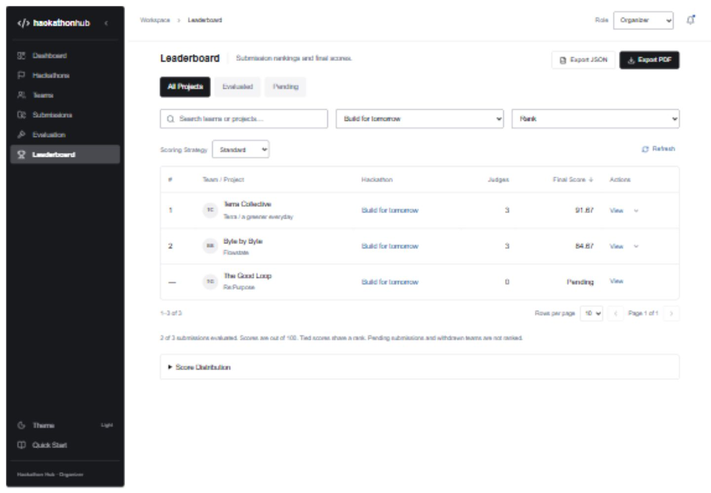
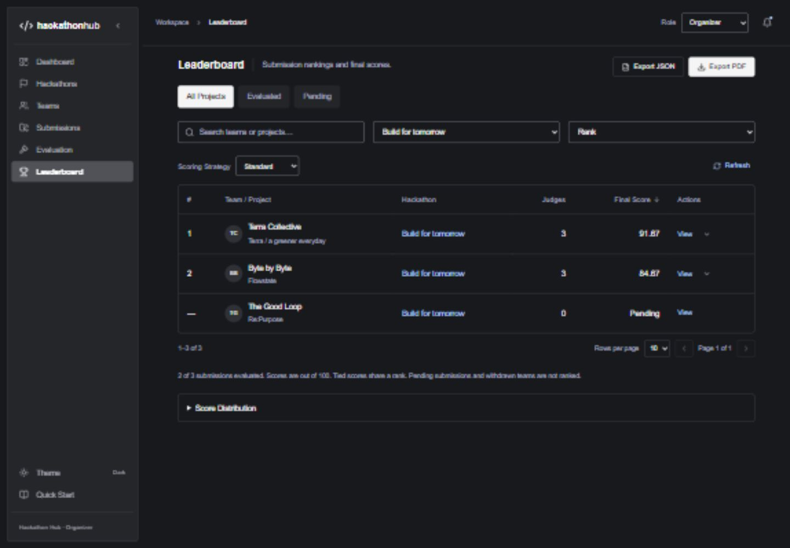

# HackerEarth reference redesign review

Reviewed November 8, 2026. This review supersedes the original visual review in `UI_UX_REVIEW.md`.

## Skill and reference

The required [UI UX Pro Max skill](https://github.com/nextlevelbuilder/ui-ux-pro-max-skill) was present at `.agents/skills/ui-ux-pro-max/SKILL.md`; no reinstallation was needed. Its design-system generator and focused React/accessibility searches were run before implementation and during final review. [MASTER.md](../design-system/hackathon-hub/MASTER.md) records the applied recommendations and design tokens.

The user's HackerEarth screenshots govern the visual direction: an inset charcoal sidebar in both themes, neutral surfaces, small page headings, restrained gray status filters, three-column filters where appropriate, and full-width bordered tables. Native dialogs, accessible contrast, and phone layouts follow the skill's relevant web guidance. The app retains Hackathon Hub branding.

## Page-by-page findings and fixes

| View | Result and verified behavior |
|---|---|
| Shared shell | Removed decorative branding/copy and fake workspace/profile labels. Implemented persisted sidebar collapse, themes, role-specific navigation, Quick Start, and the real activity dialog. Fixed collapsed labels disappearing from the mobile menu. |
| Dashboard | Replaced the promotional hero/pipeline with backend-derived counts, Active Hackathons, Recent Activity, and Upcoming Deadlines. Event/project links open their records. Failed initial loads show an error rather than zero statistics. |
| Hackathons | Replaced the card grid with a table. All, Upcoming, Active, Judging, Completed, and Cancelled filters, search, clear, pagination, Create, Edit, and View work. Status transitions retain backend rules. |
| Hackathon details | Consistent dates/status strip and keyboard-operated Tasks, Evaluation Criteria, and permitted Teams tabs. Create Task and criteria editing use existing APIs. Management actions and dialogs are organizer-only; criteria remain locked after evaluation. |
| Teams | Real member counts, project links, event/status/member filters, search, and pagination. Team editing, member entry, and project navigation were verified. No fabricated personal ownership or My Teams filter was introduced. |
| Submissions | Table shows backend titles, teams, dates, statuses, and actual leaderboard scores. Pending, unavailable, and unranked values are distinct. Event changes clear incompatible team filters. Details include recorded evaluations. Fixed modal cleanup overriding the Open Evaluation destination and added a regression test. |
| Evaluation | Pending/Completed/All filters use actual evaluation counts. Judges can submit; organizers can view and configure scoring. Deep links select the related event. Phone score inputs retain 68px width and 44px height. Withdrawn teams do not receive a misleading unevaluated message. |
| Leaderboard | Full-width ranking table with search, event/status filters, rank/team/score sorting, server ranks, score details, refresh, real JSON/PDF exports, and optional actual-data chart. No podium, decorative side panels, or invented scores. |
| Forms and dialogs | Functional field labels and concise guidance, preserved drafts/errors, busy buttons, cancel/close, and visible focus. Fixed native dialogs being pinned to the top-left by explicitly centering them. Landscape dialogs scroll within the viewport; Cancel remains reachable. |

Application labels, helper text, browser title, and metadata use functional wording. Stored event names, project descriptions, and judge comments remain backend content rather than being rewritten by the frontend.

## Role behavior

| Section/action | Organizer | Participant | Judge |
|---|---|---|---|
| Dashboard, hackathon/task/criteria read, submission read, leaderboard/export, activity | Yes | Yes | Yes |
| Teams directory and membership management | Yes | Yes | Hidden; direct route redirects |
| Hackathon/task/criteria management | Yes | Hidden | Hidden |
| Project submission/edit when backend permits | Yes | Yes | Hidden |
| Evaluation workspace/history | Read and scoring configuration | Hidden; direct route redirects | Read and submit evaluation |
| Strategy and score adjustments | Yes | Hidden | Hidden |

The original application is account-free and its API is unauthenticated. This redesign enforces the existing demo-role model in the UI, including direct-route guards. It does not claim production server authorization or per-user team ownership. No backend architecture, endpoint contract, scoring formula, persistence rule, or permission service was changed.

## Data integrity and activity

Counts are derived from API arrays; scores come from the leaderboard API. The frontend has no fallback arrays of people, activities, or scores. Existing persisted demonstration records remain in the main database. All newly created review records were confined to `hackathon_hub_review` on the separate 8081/5174 review servers.

Submission activity uses the recorded team name; evaluation activity uses the recorded judge name. The existing backend stores those in messages, so the frontend extracts them and links matching projects. Historical titles remain visible if a project was renamed. Team-status notifications do not record the person responsible: the Actor column says **Not recorded** rather than inventing an organizer. Each row includes its actual event and timestamp, with the stored ISO timestamp in the `time` element.

## Interaction verification

The isolated browser journey created a hackathon, coding task, saved criteria, team, and participant; changed team status; submitted and edited a project as Participant; and submitted a Judge evaluation. The stored scores 7/8/9/8 produced base 80. Organizer scoring controls enabled two +5 bonuses and the backend returned 90. Strategy selection and the leaderboard agreed. JSON and PDF buttons produced real downloads; JSON contained the same stored records and 90-point result.

Search/filter empty states, Clear Filters, team/project navigation, evaluation deep links, status movement after evaluation, read activity state, chart disclosure, score breakdowns, sort order, role switching, theme/collapse persistence, and Quick Start were checked. Keyboard Escape dismissed a dialog and restored focus to its opener. Table regions support keyboard focus and contained horizontal scrolling. Automated pagination tests use enough rows to exercise Next/Previous and page-size/filter resets. Management-dialog cancellation is checked without sending writes; destructive backend behavior remains covered by the existing regression suite.

Stopping only the review backend caused a real connection failure. The application displayed retry UI without false zero statistics, then recovered when the backend returned. A regression test additionally holds a retry pending and verifies a loading state until actual data arrives. Background revalidation preserves form drafts and refreshes dependent scores.

## Responsive and visual review

All seven views were inspected and checked at **375, 768, 1024, and 1440 CSS pixels in both themes**. The [56-entry geometry log](screenshots/redesign-geometry.json) records no page-level horizontal overflow or alert states. Tables scroll within their own labeled regions. Phone status filters wrap, phone controls have larger targets, and long form dialogs remain scrollable in 812×375 landscape. These are browser viewport checks, not physical-device testing.

Reduced motion was emulated and verified: dialog animation `none`, button transition `0s`. The emulation and temporary viewport overrides were reset after review. Browser logs were clean before deliberately testing the stopped backend.

| Measured pair | Light ratio | Dark ratio |
|---|---:|---:|
| Main text on surface | 17.74:1 | 16.13:1 |
| Secondary text on surface / raised dark surface | 5.37:1 | 7.16:1 |
| Link on surface | 6.79:1 | 11.04:1 |
| Sidebar secondary text | 7.44:1 | 7.01:1 |
| Input/filter boundary on surface | 3.17:1 | 4.26:1 |
| Focus ring on surface | 5.40:1 | 8.95:1 |

Ratios were calculated from the implemented semantic colors. Normal text exceeds 4.5:1; listed control boundaries and focus rings exceed 3:1. Thin table separators are decorative. This is not a claim of formal accessibility certification or assistive-technology coverage.

## Evidence and checks

- `npm test`: 23 frontend interaction/regression tests.
- `npm run build`: TypeScript and production Vite build.
- `./mvnw verify`: 22 existing backend tests; zero failures/errors.
- `npm audit` and `npm audit --omit=dev`: zero known dependency vulnerabilities.
- Backend source and database migration files unchanged.

Final screenshots are under `docs/screenshots/redesign-*`: seven light desktop views, seven dark desktop views, seven phone views, the judge form, centered dark landscape form, and the geometry log.

